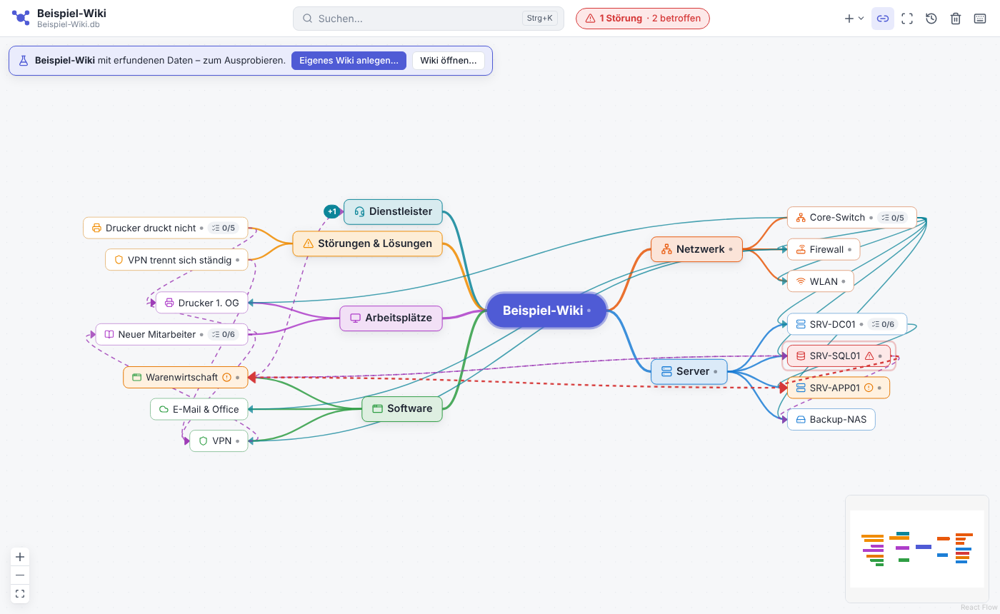
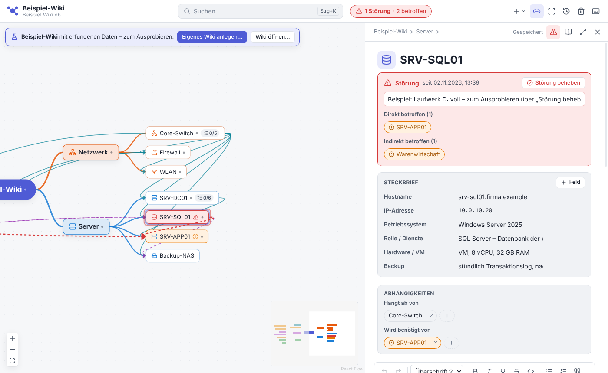

# MindWiki

Lokales Wiki als Mind Map: Artikel hängen in einem Baum (Hauptthema in der Mitte), können per `[[` aufeinander verweisen und enthalten abhakbare Abläufe mit Protokoll. Alles liegt in **einer** SQLite-Datei auf deinem Rechner.

**⬇ [Neueste Version für Windows herunterladen](https://github.com/benni-252/MindWiki/releases/latest)**



## Programm benutzen

- **Beispiel-Wiki:** Beim ersten Start öffnet MindWiki ein Beispiel mit erfundenen IT-Daten (Netzwerk, Server, Software, Abläufe, Abhängigkeiten und eine Beispiel-Störung), damit man sofort sieht, wie alles aussieht. Es liegt als eigene Datei `Dokumente\MindWiki\Beispiel-Wiki.db` neben deinem Wiki. *Datei › Neues Wiki* legt ein eigenes, leeres Wiki an; das Beispiel bleibt unter *Hilfe › Beispiel-Wiki öffnen* erreichbar. Wer schon ein Wiki hat, bei dem ändert sich nichts.

- **Herunterladen:** Die fertigen .exe-Dateien liegen auf GitHub unter **Releases** (rechts auf der Repo-Seite). Im Repository selbst sind sie absichtlich nicht enthalten (`dist/` steht in `.gitignore`), sie werden vom Workflow `Windows-Build` erzeugt – siehe [Windows-Programme auf GitHub bauen](#windows-programme-auf-github-bauen).
- **Installieren:** `MindWiki-Setup-<Version>.exe` ausführen – oder ohne Installation `MindWiki-<Version>-portable.exe` starten.
  Die .exe ist nicht signiert; Windows SmartScreen fragt beim ersten Start nach („Weitere Informationen“ → „Trotzdem ausführen“).
- **Updates:** Die installierte Version prüft beim Start und alle paar Stunden, ob es auf GitHub eine neue Version gibt. Dann erscheint oben „Update … verfügbar“; ein Klick lädt sie herunter und installiert sie mit einem kurzen Neustart (deine Daten bleiben erhalten). Von Hand: *Hilfe › Nach Updates suchen…*. Die portable Version zeigt nur den Hinweis und öffnet die Download-Seite. Dafür muss das GitHub-Repository öffentlich sein. MindWiki nutzt die Proxy-Einstellungen von Windows; verlangt ein Firmen-Proxy Benutzername und Passwort, fragt MindWiki danach und merkt sich die Anmeldung auf Wunsch verschlüsselt für das Windows-Konto (löschen unter *Hilfe › Nach Updates suchen…*).
- **Daten:** standardmäßig `Dokumente\MindWiki\Wiki.db`. Über *Datei › Neues Wiki / Wiki öffnen* kannst du weitere Wikis anlegen bzw. wechseln.
- **Speichern:** Texte speichert MindWiki kurz nach dem Tippen automatisch; oben im Artikel steht „Gespeichert“. Sofort speichern: Knopf neben der Anzeige oder Strg+S (*Datei › Speichern*). Ist die Wiki-Datei nicht erreichbar (Netzlaufwerk getrennt, Datei gesperrt), bleibt der Text im Artikel stehen, wird zusätzlich auf diesem Rechner aufgehoben (`%APPDATA%\MindWiki\Nicht-gespeichert.json`), und MindWiki versucht es von selbst weiter. Wer den Artikel oder MindWiki dann schließen will, wird gefragt. Beim nächsten Öffnen lässt sich der aufgehobene Text wiederherstellen, kopieren oder verwerfen.
- **Sicherungen:** beim Start höchstens einmal pro Tag automatisch in `Sicherungen\` neben der Datenbank (die letzten 5 bleiben), außerdem vor jedem Datenbank-Update eine Kopie „…_vor-Update-vN“. Manuell: *Datei › Sicherung erstellen* (Strg+Umschalt+S) – am besten auf ein anderes Laufwerk, denn liegt die Wiki-Datei auf einem Netzlaufwerk, liegen die automatischen Sicherungen mit dort. Zurückholen: *Datei › Wiki öffnen* und die Sicherung wählen (oder die Sicherungsdatei an die Stelle der Wiki-Datei kopieren, wenn niemand MindWiki offen hat).
- **Anhänge:** Im Artikel unter *Anhänge* Dokumente (PDF, Word, Excel, Visio, Bilder, ZIP …) anhängen – über *Datei anhängen…* oder per Ziehen aus dem Explorer auf den Bereich oder den Text. Bis 50 MB pro Datei; Programme und Skripte (.exe, .bat, .ps1 …) sind aus Sicherheitsgründen gesperrt. Die Dateien liegen in der Wiki-Datei (und damit in jeder Sicherung). *Öffnen* zeigt eine schreibgeschützte Kopie im passenden Programm, *Speichern unter…* legt eine Kopie ab. In der Mind Map zeigt eine Büroklammer, wie viele Anhänge ein Artikel hat. Mit Freigabe-Pflicht laufen neue oder entfernte Anhänge wie andere Änderungen über die Freigabe.
- **Mind Map frei anordnen:** Artikel lassen sich mit der Maus an jede Stelle ziehen; ihre Unterartikel wandern mit, neue Unterartikel reihen sich daneben ein. Auf einen anderen Artikel gezogen, wird er wie bisher umgehängt. Die Anordnung liegt in der Wiki-Datei und gilt für alle. Zurück zur automatischen Anordnung: Rechtsklick › *Ast automatisch anordnen* oder *Ansicht › Mind Map automatisch anordnen*. Ältere MindWiki-Versionen können dieselbe Datei weiter öffnen (sie zeigen die automatische Anordnung).
- **Als PDF exportieren:** Knopf oben im Artikel, Rechtsklick in der Mind Map oder *Datei › Artikel als PDF exportieren* (Strg+P). Das PDF enthält Pfad, Steckbrief (Passwort-Felder unkenntlich), Text mit Bildern und Tabellen, Abläufe zum Abhaken, Abhängigkeiten sowie Hinweise auf Störungen oder nicht freigegebene Entwürfe.
- **Papierkorb:** Gelöschte Äste lassen sich unter *Bearbeiten › Papierkorb* wiederherstellen.

### Anmeldung, Benutzer und Rollen

- Beim Start meldet man sich mit **Benutzername und Passwort** an. Die Benutzer stehen in der Wiki-Datei und gelten damit für alle, die sie benutzen.
- Jedes Wiki hat den **Admin** `admin`, anfangs mit dem Passwort `admin`. Solange es nicht geändert ist, erinnert ein Hinweis daran (oder: Benutzer-Menü oben rechts › *Passwort ändern*).
- Nur der Admin legt Benutzer an, ändert Rollen, setzt Passwörter zurück und löscht Benutzer (Benutzer-Menü › *Benutzer verwalten*). Außerdem schaltet nur er die Freigabe-Pflicht ein oder aus.
- **Rollen:** *Mitarbeiter* verfassen und ändern Artikel. *Bearbeiter* dürfen zusätzlich freigeben, ablehnen und den Papierkorb endgültig leeren. Freigeben dürfen sie nie ihre eigenen Artikel oder Änderungen.
- **Gelöschte Benutzer** können sich nicht mehr anmelden. Ihre Artikel bleiben erhalten und sind gekennzeichnet (Symbol am Knoten, Hinweis „Verfasst von … – dieser Benutzer wurde gelöscht“, durchgestrichener Name im Verlauf). Der Name kann nicht neu vergeben werden.
- Die Rechte prüft der Hauptprozess, Passwörter werden nur als Hash gespeichert. Aber: Die Anmeldung schützt vor Versehen im Team, nicht die Datei selbst – wer die Datei direkt öffnen kann, kommt an den Inhalt. Das Admin-Passwort gut aufbewahren, es lässt sich nicht wiederherstellen.
- Im Beispiel-Wiki gibt es die Zugänge `admin`/`admin`, `Anna`/`demo` (Bearbeiter) und `Ben`/`demo` (Mitarbeiter).

### Gemeinsam mit anderen nutzen

- **Eine Datei für alle:** Die Wiki-Datei auf ein Netzlaufwerk bzw. eine Server-Freigabe legen (z. B. `\\server\IT\Wiki.db`). Jeder öffnet sie über *Datei › Wiki öffnen*. Änderungen der anderen erscheinen nach ein bis zwei Sekunden von selbst; ist ein Artikel gerade offen, wird er neu geladen. Alle sollten dieselbe MindWiki-Version verwenden.
- **Verlauf:** Unten in jedem Artikel steht, wer wann was geändert hat – Titel, Text, Steckbrief-Felder, Abläufe, Abhängigkeiten, Störungen, Verschieben und Papierkorb. Werte von Passwort-Feldern landen nicht im Verlauf.
- **Frühere Textfassungen:** Bei Textänderungen zeigt „Text davor ansehen“, wie der Text vorher aussah; „Diese Fassung wiederherstellen“ holt ihn zurück. Je Artikel bleiben die letzten 30 Fassungen erhalten.
- **Neu von anderen:** Hat jemand anderes einen Artikel geändert, seit du ihn zuletzt angesehen hast, trägt der Knoten einen blauen Punkt und das Uhr-Symbol oben zeigt die Anzahl. Ein Klick (oder Strg+Umschalt+H) öffnet *Letzte Änderungen*. Dort durchsucht das Suchfeld den ganzen Verlauf des Wikis – nach Artikel, Person, Beschreibung der Änderung (z. B. einem Wert aus dem Steckbrief oder einem alten Titel) oder Datum (TT.MM.JJJJ); mehrere Wörter müssen alle vorkommen, Treffer sind markiert, Esc leert die Suche.
- **Name im Verlauf:** Änderungen erscheinen mit dem Benutzernamen, mit dem man angemeldet ist.
- Ein- und Ausklappen von Ästen ist in der Datei gespeichert und gilt damit für alle.

### Freigaben (Vier-Augen-Prinzip)

Der Admin schaltet sie unter *Freigaben einstellen* im Benutzer-Menü ein (gilt für alle, die die Wiki-Datei benutzen):

- **Neue Artikel** sind zunächst Entwürfe: in der Mind Map gestrichelt, im Artikel steht „wartet auf Freigabe“. Die Autorin kann sie weiter bearbeiten; freigeben oder ablehnen kann ein Bearbeiter oder der Admin, aber nicht die Autorin selbst. Abgelehnte Artikel landen im Papierkorb.
- **Änderungen an freigegebenen Artikeln** beginnen mit „Bearbeiten“: Man arbeitet an einem eigenen Entwurf (Text, Titel, Symbol, Steckbrief, Abläufe), die anderen sehen so lange den freigegebenen Stand. Ein Stift-Symbol am Knoten zeigt den offenen Vorschlag. Andere sehen mit „Änderungen ansehen“ den Vergleich (rot bisher, grün neu) und können freigeben oder mit Begründung ablehnen. Pro Artikel gibt es höchstens einen offenen Vorschlag.
- Text, der noch nicht freigegeben ist, ist markiert: bei neuen Artikeln der ganze Text, im eigenen Entwurf die geänderten Absätze (gelb).
- Oben steht „X Freigaben offen“, sobald etwas offen ist – orange, wenn etwas auf deine Freigabe wartet, blau, wenn nur deine eigenen Entwürfe auf andere warten. Ein Klick zeigt die Liste.
- Sofort und ohne Freigabe gehen weiterhin: Störung melden/beheben, Abhängigkeiten, Abläufe abhaken und protokollieren, Verschieben, Papierkorb.
- Beim Ausschalten werden alle offenen Entwürfe übernommen. Ein- und ausschalten kann nur der Admin (Benutzer-Menü › *Freigaben einstellen*).

### IT-Funktionen



- **Vorlagen:** Server / System, Netzwerkgerät, Software, Anleitung, Störung / Fehlerbehebung, Dienstleister / Kontakt – jeweils mit Steckbrief-Feldern, Gliederung und passendem Ablauf. Erreichbar über den Plus-Knopf oben, per Rechtsklick „Unterartikel aus Vorlage“ oder in einem leeren Artikel über „Mit Vorlage starten“.
- **Steckbrief:** frei benennbare Felder (Hostname, IP-Adresse, Standort …) oben im Artikel, mit Kopieren-Knopf und Vorschlägen beim Tippen; die Suche findet auch Feldwerte. Passwörter gehören in einen Passwort-Manager – die Wiki-Datei ist nicht verschlüsselt.
- **Abhängigkeiten:** Im Artikel unter „Abhängigkeiten“ eintragen, wovon er abhängt (z. B. Warenwirtschaft → App-Server → SQL-Server → Core-Switch) – oder umgekehrt, welche Artikel ihn brauchen. In der Mind Map erscheinen sie als türkise Pfeile (zusammen mit den Querverweisen ein-/ausblendbar). Der Pfeil zeigt, wohin sich eine Störung ausbreitet.
- **Störungen:** Rechtsklick auf einen Artikel › „Störung melden“ (oder das Warndreieck oben im Artikel). Der Artikel wird rot, alles, was direkt oder über mehrere Stufen davon abhängt, orange. Die Wege der Störung sind als rote Pfeile immer zu sehen, und eingeklappte Äste färben ihren Zähler ein. Im gestörten Artikel stehen Beginn, eine Notiz und die direkt bzw. indirekt betroffenen Artikel; ein betroffener Artikel zeigt, über welchen Weg ihn die Störung erreicht. Oben erscheint „1 Störung · 4 betroffen“ – ein Klick öffnet die Übersicht (auch *Ansicht › Störungen und Auswirkungen*). „Störung beheben“ setzt alles zurück.
- **Symbole:** 35 IT-Symbole (Server, Netzwerk, Drucker, Datenbank, Cloud …) für die Knoten – per Rechtsklick „Symbol wählen“ oder über das Symbol neben dem Artikeltitel.

### Wichtigste Kürzel (F1 zeigt alle)

| Kürzel | Wirkung |
|---|---|
| Tab / Enter | Unterartikel / Artikel daneben anlegen |
| F2, Doppelklick | Umbenennen |
| Leertaste | Ast ein-/ausklappen |
| Pfeiltasten, Alt+↑/↓ | Navigieren, Reihenfolge ändern |
| Knoten auf anderen ziehen | Umhängen |
| Knoten ins Freie ziehen | Frei platzieren (Unterartikel wandern mit) |
| Strg+K | Suchen (Titel, Text, Ablaufschritte) |
| Strg+Umschalt+H | Letzte Änderungen (auch von anderen) |
| `[[` im Text | Anderen Artikel verlinken (erscheint als gestrichelte Linie in der Mind Map) |
| Strg+V | Bild/Screenshot einfügen |

## Entwicklung

Voraussetzung: Node.js 24.

```bash
npm install
npm run dev          # App mit Live-Neuladen starten
npm test             # Unit-Tests (Datenbank, Layout)
npm run e2e          # baut und testet die echte App mit Playwright
npm run typecheck
npm run build:win    # Installer + portable .exe nach dist\
node scripts/make-icon.mjs   # App-Symbol neu erzeugen
```

Falls Electron beim ersten Start fehlt: `node node_modules/electron/install.js`.

### Windows-Programme auf GitHub bauen

Der Workflow `.github/workflows/windows-build.yml` baut Installer und portable .exe auf einem Windows-Rechner von GitHub:

- **Automatisch bei jeder Änderung auf `master`** (z. B. nach dem Mergen eines Pull Requests): Nach etwa 10 Minuten liegt der neue Stand im Release `v<Version>`. Gibt es das Release für die Version aus `package.json` noch nicht, wird es angelegt – die Beschreibung kommt aus dem passenden Abschnitt in `CHANGELOG.md`. Gibt es das Release schon, werden seine .exe-Dateien ersetzt. Der Download-Link [releases/latest](https://github.com/benni-252/MindWiki/releases/latest) zeigt damit immer den aktuellen Stand.
- **Pull Requests** werden zur Kontrolle gebaut; die .exe liegt im Lauf unter *Artifacts* als ZIP.
- **Von Hand:** *Actions › Windows-Build › Run workflow*.

Für eine neue Version `version` in `package.json` erhöhen und in `CHANGELOG.md` einen Abschnitt `## <Version>` ergänzen.

### Aufbau

- `src/main` – Electron-Hauptprozess: Datenbank (`db.ts`, `store.ts`, eingebautes `node:sqlite`), IPC (`ipc.ts`), Fenster/Menü (`index.ts`), Bilder über das Protokoll `wikiimg://`
- `src/preload` – stellt der Oberfläche die typisierte `window.wiki`-API bereit
- `src/shared/types.ts` – gemeinsame Typen und Liste der IPC-Methoden
- `src/shared/impact.ts` – welche Artikel von einer Störung betroffen sind (über die Abhängigkeiten)
- `src/renderer/src` – React-Oberfläche: `mindmap/` (React Flow + Layout), `article/` (TipTap-Editor), `checklist/` (Abläufe), `dialogs/`
